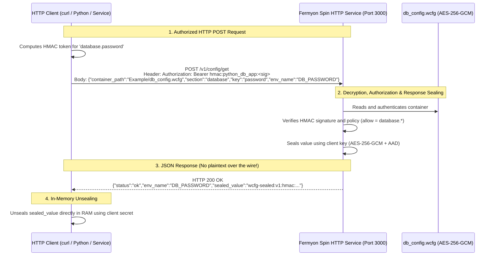

# Practical Example: Fermyon Spin HTTP Micro-Vault Service

This example demonstrates how configuration values from an encrypted INI container (`Example/db_config.wcfg`) can be queried over the **Fermyon Spin HTTP Service** and securely unsealed inside the requesting client application.

---

## 1. Overview & Architecture

Instead of executing the WASI binary as a CLI subprocess, `wasm_config_provider_spin` runs as a lightweight, serverless HTTP micro-vault service inside Fermyon Spin:



---

## 2. Starting the Spin Service

### A) Build the Spin WASI Component
```bash
cargo build --bin wasm_config_provider_spin --target wasm32-wasip2 --release
```

### B) Launch the Spin Service
```bash
spin up --file spin/spin.toml
```

By default, the service listens on `http://127.0.0.1:3000`.

---

## 3. Querying via `curl`

### Step 1: Compute Token for the Client
For client `python_db_app` with secret `4f8b2c19a7d3e605112233445566778899aabbccddeeff00123456789abcdef0`:

```bash
# Generate token via CLI (or compute locally via HMAC-SHA256):
TOKEN=$(wasmtime run target/wasm32-wasip2/release/wasm_config-mgr.wasm \
  token \
  --client python_db_app \
  --section database \
  --key password \
  --hmac-secret 4f8b2c19a7d3e605112233445566778899aabbccddeeff00123456789abcdef0)

echo "$TOKEN"
# Example: hmac:python_db_app:783ccc054de425b3fbe56286...
```

### Step 2: HTTP POST to the Spin Micro-Vault
```bash
curl -i -X POST http://127.0.0.1:3000/v1/config/get \
  -H "Authorization: Bearer $TOKEN" \
  -H "Content-Type: application/json" \
  -d '{
    "container_path": "Example/db_config.wcfg",
    "section": "database",
    "key": "password",
    "env_name": "DB_PASSWORD"
  }'
```

#### HTTP Response:
```http
HTTP/1.1 200 OK
content-type: application/json
content-length: 154

{
  "status": "ok",
  "env_name": "DB_PASSWORD",
  "sealed_value": "wcfg-sealed:v1:hmac:7684ef10d3b789271a435d92:7522b2673a0d91df9ffa491207232dc677cdc884acc7c7665f4cf8bf504556768febb2bcf650a487b7dfa7"
}
```

> [!NOTE]
> The real password is **never transmitted in plaintext** across the network. Even over unencrypted local HTTP traffic, the response is protected by client-specific AES-256-GCM response sealing.

---

## 4. Example Client in Python

Here is a concise Python script querying the HTTP endpoint and unsealing the value in memory:

```python
import hashlib
import hmac
import requests
from cryptography.hazmat.primitives.ciphers.aead import AESGCM

CLIENT_ID = "python_db_app"
CLIENT_SECRET = bytes.fromhex("4f8b2c19a7d3e605112233445566778899aabbccddeeff00123456789abcdef0")

# 1. Compute HMAC token locally
msg = f"wasm-config-mgr:v1:{CLIENT_ID}:database:password".encode("utf-8")
sig = hmac.new(CLIENT_SECRET, msg, hashlib.sha256).hexdigest()
token = f"hmac:{CLIENT_ID}:{sig}"

# 2. HTTP POST to Spin service
resp = requests.post(
    "http://127.0.0.1:3000/v1/config/get",
    headers={"Authorization": f"Bearer {token}"},
    json={
        "container_path": "Example/db_config.wcfg",
        "section": "database",
        "key": "password",
        "env_name": "DB_PASSWORD",
    },
)
resp.raise_for_status()
data = resp.json()
sealed_val = data["sealed_value"]

# 3. Unseal value in RAM
prefix = "wcfg-sealed:v1:hmac:"
nonce_hex, cipher_hex = sealed_val[len(prefix):].split(":", 1)
nonce = bytes.fromhex(nonce_hex)
ciphertext = bytes.fromhex(cipher_hex)

key_info = f"wasm-config-mgr:seal-key:v1:{CLIENT_ID}:database:password:DB_PASSWORD".encode("utf-8")
seal_key = hmac.new(CLIENT_SECRET, key_info, hashlib.sha256).digest()
aad = f"wasm-config-mgr:seal-aad:v1:{CLIENT_ID}:database:password:DB_PASSWORD".encode("utf-8")

db_password = AESGCM(seal_key).decrypt(nonce, ciphertext, aad).decode("utf-8")
print(f"Successfully unsealed: {db_password}")
```

---

## 5. Error Behavior & Security Protections

- **Missing Token:** Returns `HTTP 401 Unauthorized`.
- **Invalid Signature:** Returns `HTTP 401 Unauthorized` (`cryptographic token verification failed`).
- **Disallowed Key:** (e.g., `section: admin`, `key: root_api_token`) Returns `HTTP 403 Forbidden` (`client is not permitted to access`).
- **Context Tampering:** If an attacker alters `env_name` or `section`, client unsealing fails (`AuthenticationFailed`) because the context is bound as AAD into the response tag.
