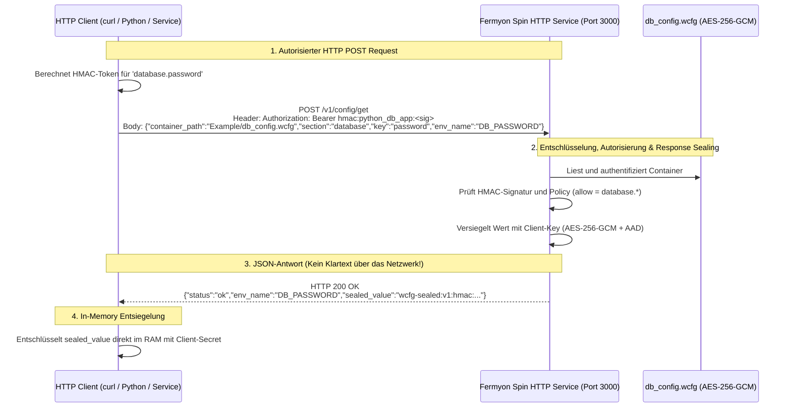

# Praxisbeispiel: Fermyon Spin HTTP Micro-Vault Service

Dieses Beispiel zeigt, wie Konfigurationswerte aus einer verschlüsselten INI-Datei (`Example/db_config.wcfg`) über den **Fermyon Spin HTTP Service** abgefragt und im anfragenden Client sicher entsiegelt werden.

---

## 1. Übersicht & Architektur

Statt das WASI-Binary als Subprozess auszuführen, läuft `wasm_config_provider_spin` als leichtgewichtiger, serverloser HTTP-Dienst in Fermyon Spin:



---

## 2. Starten des Spin-Dienstes

### A) Kompilieren der Spin-WASI-Komponente
```bash
cargo build --bin wasm_config_provider_spin --target wasm32-wasip2 --release
```

### B) Spin Service starten
```bash
spin up --file spin/spin.toml
```

Der Dienst lauscht standardmäßig auf `http://127.0.0.1:3000`.

---

## 3. Abfrage mit `curl`

### Schritt 1: Token für den Client berechnen
Für den Client `python_db_app` mit dem Secret `4f8b2c19a7d3e605112233445566778899aabbccddeeff00123456789abcdef0`:

```bash
# Token über CLI generieren (oder im Client per HMAC-SHA256 berechnen):
TOKEN=$(wasmtime run target/wasm32-wasip2/release/wasm_config-mgr.wasm \
  token \
  --client python_db_app \
  --section database \
  --key password \
  --hmac-secret 4f8b2c19a7d3e605112233445566778899aabbccddeeff00123456789abcdef0)

echo "$TOKEN"
# Beispiel: hmac:python_db_app:783ccc054de425b3fbe56286...
```

### Schritt 2: HTTP POST an den Spin Micro-Vault
```bash
curl -i -X POST http://127.0.0.1:3000/v1/config/get \
  -H "Authorization: Bearer $TOKEN" \
  -H "Content-Type: application/json" \
  -d '{
    "container_path": "Example/db_config.wcfg",
    "section": "database",
    "key": "password",
    "env_name": "DB_PASSWORD"
  }'
```

#### HTTP-Antwort:
```http
HTTP/1.1 200 OK
content-type: application/json
content-length: 154

{
  "status": "ok",
  "env_name": "DB_PASSWORD",
  "sealed_value": "wcfg-sealed:v1:hmac:7684ef10d3b789271a435d92:7522b2673a0d91df9ffa491207232dc677cdc884acc7c7665f4cf8bf504556768febb2bcf650a487b7dfa7"
}
```

> [!NOTE]
> Das echte Passwort wird **zu keinem Zeitpunkt** im Klartext über das HTTP-Netzwerk übertragen. Auch bei unverschlüsseltem internem HTTP-Verkehr ist die Antwort durch das client-spezifische Response Sealing geschützt.

---

## 4. Beispiel-Client in Python

Hier ist ein kurzes Python-Skript, das die Abfrage über HTTP durchführt und den Wert direkt im RAM entschlüsselt:

```python
import hashlib
import hmac
import requests
from cryptography.hazmat.primitives.ciphers.aead import AESGCM

CLIENT_ID = "python_db_app"
CLIENT_SECRET = bytes.fromhex("4f8b2c19a7d3e605112233445566778899aabbccddeeff00123456789abcdef0")

# 1. HMAC Token lokal berechnen
msg = f"wasm-config-mgr:v1:{CLIENT_ID}:database:password".encode("utf-8")
sig = hmac.new(CLIENT_SECRET, msg, hashlib.sha256).hexdigest()
token = f"hmac:{CLIENT_ID}:{sig}"

# 2. HTTP POST an Spin Service
resp = requests.post(
    "http://127.0.0.1:3000/v1/config/get",
    headers={"Authorization": f"Bearer {token}"},
    json={
        "container_path": "Example/db_config.wcfg",
        "section": "database",
        "key": "password",
        "env_name": "DB_PASSWORD",
    },
)
resp.raise_for_status()
data = resp.json()
sealed_val = data["sealed_value"]

# 3. Sealed-Wert im RAM entschlüsseln
prefix = "wcfg-sealed:v1:hmac:"
nonce_hex, cipher_hex = sealed_val[len(prefix):].split(":", 1)
nonce = bytes.fromhex(nonce_hex)
ciphertext = bytes.fromhex(cipher_hex)

key_info = f"wasm-config-mgr:seal-key:v1:{CLIENT_ID}:database:password:DB_PASSWORD".encode("utf-8")
seal_key = hmac.new(CLIENT_SECRET, key_info, hashlib.sha256).digest()
aad = f"wasm-config-mgr:seal-aad:v1:{CLIENT_ID}:database:password:DB_PASSWORD".encode("utf-8")

db_password = AESGCM(seal_key).decrypt(nonce, ciphertext, aad).decode("utf-8")
print(f"Erfolgreich entsiegelt: {db_password}")
```

---

## 5. Fehlerverhalten & Schutz vor unbefugtem Zugriff

- **Fehlendes Token:** Liefert sofort `HTTP 401 Unauthorized`.
- **Falsche Signatur:** Liefert `HTTP 401 Unauthorized` (`cryptographic token verification failed`).
- **Nicht freigegebener Key:** (z. B. `section: admin`, `key: root_api_token`) Liefert `HTTP 403 Forbidden` (`client is not permitted to access`).
- **Manipulierter Context:** Ändert ein Angreifer `env_name` oder `section`, schlägt die Entschlüsselung im Client (`AuthenticationFailed`) fehl, da der Kontext fest als AAD in den Tag gebunden ist.
