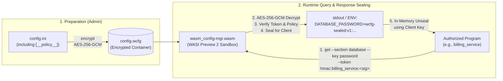

# `wasm_config-mgr` — WASI Preview 2 AES-256-GCM INI Configuration Manager

-654FF0?logo=webassembly)


-2ea44f)

`wasm_config-mgr` is a **WebAssembly System Interface (WASI Preview 2)** application developed in Rust for securely managing sensitive configuration data in INI format.

It encrypts INI files including an embedded access policy manifest (`[__policy__]`) using **AES-256-GCM** and provides authorized client programs, following cryptographic token and policy verification, with individually requested configuration entries as **end-to-end sealed environment variables (`ENV_KEY=wcfg-sealed:v1:...`)** over `stdout` — ensuring plaintext secrets are never exposed on `stdout`, in console logs, or in `/proc/<pid>/environ`.

---

## Table of Contents

1. [Key Features](#key-features)
2. [Architecture & Security Model](#architecture--security-model)
3. [Build & Installation](#build--installation)
4. [Example INI with Policy Manifest](#example-ini-with-policy-manifest)
5. [Encryption & Decryption](#encryption--decryption)
6. [Authorization, Response Sealing & Client Usage](#authorization-response-sealing--client-usage)
7. [Full Practical Example (`./Example`)](#full-practical-example-example)
8. [CLI Reference](#cli-reference)
9. [Binary Container Format (`WCFG`)](#binary-container-format-wcfg)
10. [Tests & Spec-Driven Development (`sdd`)](#tests--spec-driven-development-sdd)

---

## Key Features

- **Authenticated Encryption at Rest (AES-256-GCM):** Protects both the confidentiality and integrity of the entire INI file. The 34-byte binary container header is authenticated as *Associated Data (AAD)*, ensuring any modification to the header or ciphertext is immediately detected.
- **End-to-End Response Sealing (No Plaintext on `stdout`):**
  - Even after successful authorization, `get` **never outputs the plaintext value** on `stdout`. Instead, it seals the value specifically for the requesting client with AES-256-GCM (`wcfg-sealed:v1:hmac:...` or asymmetric ephemeral Curve25519-ECDH `wcfg-sealed:v1:ed25519:...`).
  - The target environment variable name, `client_id`, `section`, and `key` are bound as AAD into the response's GCM authentication tag.
  - Only the authorized target program unseals (`unseal` / Rust API `unseal_env_value` / Python `unseal_in_memory_python`) the value in its own process memory (`Zeroizing<String>`).
- **Flexible Key Management:**
  - **Direct 256-bit Master Key** (64 hex chars, 44 base64 chars, or 32 raw bytes) via environment variable (`WASM_CONFIG_MASTER_KEY`), key file, or CLI parameter.
  - **Passphrase Derivation via Argon2id** (128-bit random salt stored in header) via `WASM_CONFIG_PASSPHRASE` or `--passphrase`.
- **Embedded Policy Manifest (`[__policy__]`):** Access rules (which client may read which `section.key` patterns, including wildcards such as `stripe.*`) are stored directly inside the encrypted INI file and are thus tamper-proof.
- **Cryptographic Client Authorization:** Supports both **HMAC-SHA256** and **Ed25519** signatures over canonical request messages (`wasm-config-mgr:v1:<client_id>:<section>:<key>`).
- **WASI Component Model (WIT Export):** Exports `wasm-config:provider/reader@0.1.0` (`wit/config-provider.wit`) for direct in-process retrieval by other WASI Preview 2 components.
- **Fermyon Spin Micro-Vault HTTP Service (`wasi:http`):** Provides a lightweight, serverless HTTP endpoint (`spin/spin.toml` / `POST /v1/config/get`) delivering sealed values to microservices and containers.
- **Memory Safety:** Sensitive key material and decrypted plaintext in RAM are zeroed after use with `zeroize`.

---

## Architecture & Security Model



The project is structured according to the [Constitution](constitution.md) into four layers:

| Layer | Module | Responsibility |
| :--- | :--- | :--- |
| **INI & Policy** | [`src/ini/mod.rs`](src/ini/mod.rs) | Parsing, serialization, and extraction of `[__policy__]` rules |
| **Cryptography** | [`src/crypto/mod.rs`](src/crypto/mod.rs) | `WCFG` container format, AES-256-GCM (with header AAD), Argon2id KDF & end-to-end response sealing |
| **Authorization** | [`src/auth/mod.rs`](src/auth/mod.rs) | HMAC-SHA256 (constant-time) & Ed25519 token verification and allowlist matching |
| **CLI & ENV** | [`src/cli/mod.rs`](src/cli/mod.rs) | WASI CLI parsing, file I/O, sealed ENV formatting, and unsealing |

---

## Build & Installation

### Prerequisites

- **Rust Toolchain** (`rustc` / `cargo`) with target `wasm32-wasip2`:
  ```bash
  rustup target add wasm32-wasip2
  ```
- A WASI Preview 2 compatible runtime like [`wasmtime`](https://wasmtime.dev/) (or execution as a native host binary).

### Compilation

```bash
# 1. Build as WASI Preview 2 WebAssembly module (Release)
cargo build --target wasm32-wasip2 --release
# Artifact: target/wasm32-wasip2/release/wasm_config-mgr.wasm

# 2. Alternatively: Build as a native host binary
cargo build --release
# Artifact: target/release/wasm_config-mgr
```

---

## Example INI with Policy Manifest

An INI file contains standard configuration sections alongside the reserved section `[__policy__]`. There, authorized clients are registered with their cryptographic key (`hmac_secret` or `ed25519_pubkey`) and permission rules (`allow`).

Create a file `app_config.ini`:

```ini
# ============================================================================
# Access Policy Manifest (Encrypted together with the INI file via AES-256-GCM)
# ============================================================================
[__policy__]
# Client 1: "billing_service" authenticates using HMAC-SHA256
# Allowed entries: "database.password", "database.host", and all keys under "stripe.*"
client.billing_service.hmac_secret = 00112233445566778899aabbccddeeff00112233445566778899aabbccddeeff
client.billing_service.allow = database.password, database.host, stripe.*

# Client 2: "audit_worker" authenticates using Ed25519 public key (64 hex characters)
# Allowed entry: exclusively "logging.endpoint"
client.audit_worker.ed25519_pubkey = d75a980182b10ab7d54bfed3c964073a0ee172f3daa62325af021a68f707511a
client.audit_worker.allow = logging.endpoint

# ============================================================================
# Application Configuration
# ============================================================================
[database]
host = "db.internal.example.com"
port = 5432 ; default postgresql port
password = "s3cr3t_db_p@ssw0rd!"

[stripe]
api_key = "sk_live_9876543210abcdef"
webhook_secret = "whsec_1234567890abcdef"

[logging]
endpoint = "https://logs.internal.example.com/ingest"
```

> [!IMPORTANT]
> The section `[__policy__]` can **never** be retrieved via the `get` command — even if a client possesses `allow = *.*`.

---

## Encryption & Decryption

### Option A: Encryption with a 256-bit Master Key (Recommended for Services)

Pass the master key (32 bytes / 64 hex characters) via environment variable `WASM_CONFIG_MASTER_KEY` (or `--raw-key` / `--key-file`):

```bash
export WASM_CONFIG_MASTER_KEY="0123456789abcdef0123456789abcdef0123456789abcdef0123456789abcdef"

# Using wasmtime (capability-based: grant current directory access)
wasmtime run --dir=. --env WASM_CONFIG_MASTER_KEY \
  target/wasm32-wasip2/release/wasm_config-mgr.wasm \
  encrypt --input app_config.ini --output app_config.wcfg
```

### Option B: Encryption with a Passphrase (Argon2id KDF)

When using a passphrase instead of a raw key, `wasm_config-mgr` automatically derives a 256-bit AES key using **Argon2id** (19 MiB RAM, 2 iterations, 16-byte random salt):

```bash
export WASM_CONFIG_PASSPHRASE="correct-horse-battery-staple-2026!"

wasmtime run --dir=. --env WASM_CONFIG_PASSPHRASE \
  target/wasm32-wasip2/release/wasm_config-mgr.wasm \
  encrypt --input app_config.ini --output app_config.wcfg
```

### Full Decryption (for Administrators)

```bash
# Output to file (or stdout when omitting --output)
wasmtime run --dir=. --env WASM_CONFIG_MASTER_KEY \
  target/wasm32-wasip2/release/wasm_config-mgr.wasm \
  decrypt --input app_config.wcfg --output app_config.decrypted.ini
```

---

## Authorization, Response Sealing & Client Usage

To query a configuration value from `app_config.wcfg`, the requesting client program requires a cryptographic access token for `(client_id, section, key)`.

The canonical message signed by the client is:
```text
wasm-config-mgr:v1:<client_id>:<section>:<key>
```

### 1. Generate Access Token

Tokens can be computed either by the requesting program itself or via the helper subcommand `token`:

```bash
# Generate HMAC-SHA256 token for client "billing_service" accessing "database.password"
TOKEN=$(wasmtime run target/wasm32-wasip2/release/wasm_config-mgr.wasm \
  token \
  --client billing_service \
  --section database \
  --key password \
  --hmac-secret 00112233445566778899aabbccddeeff00112233445566778899aabbccddeeff)

echo "$TOKEN"
# Output:
# hmac:billing_service:e8b8c04d34926c4b14e070894f620ff9c6e2f20b56f0d0407368089f97e12a10
```

For **Ed25519**, supply `--ed25519-privkey <64-hex-seed>`:
```bash
ED_TOKEN=$(wasmtime run target/wasm32-wasip2/release/wasm_config-mgr.wasm \
  token \
  --client audit_worker \
  --section logging \
  --key endpoint \
  --ed25519-privkey 9d61b19deffd5a60ba844af492ec2cc44449c5697b326919703bac031cae7f60)
```

### 2. Retrieve End-to-End Sealed Entry as ENV (`get`)

When retrieving values via `get`, the secret is **never emitted as plaintext** on `stdout`. Instead, `wasm_config-mgr` seals the response using AES-256-GCM derived from the client key and context (`client_id`, `section`, `key`, `env_name`):

#### Standard Output (`SECTION_KEY=wcfg-sealed:v1:...`)
```bash
wasmtime run --dir=. --env WASM_CONFIG_MASTER_KEY \
  target/wasm32-wasip2/release/wasm_config-mgr.wasm \
  get \
  --input app_config.wcfg \
  --section database \
  --key password \
  --token "$TOKEN"
```
**Sealed output on `stdout` (no plaintext!):**
```dotenv
DATABASE_PASSWORD=wcfg-sealed:v1:hmac:7f91c2a0b1e48d1122334455:9c41f77a0184e9021b5e3f810c11a9d23d841e6b4f22c8109a3b5c7d1e2f3a4b5c6d7e
```

#### Custom Variable Name & Shell Export (`--env-name` + `--export`)
```bash
wasmtime run --dir=. --env WASM_CONFIG_MASTER_KEY \
  target/wasm32-wasip2/release/wasm_config-mgr.wasm \
  get \
  --input app_config.wcfg \
  --section database \
  --key password \
  --token "$TOKEN" \
  --env-name PGPASSWORD \
  --export
```
**Sealed export on `stdout`:**
```bash
export PGPASSWORD='wcfg-sealed:v1:hmac:4a10e8f29c1130bb81234567:3e881a4b90c21f5e7a6d112233445566778899aabbccddeeff00112233445566778899'
```

> [!NOTE]
> Because `PGPASSWORD` contains only the sealed token `wcfg-sealed:v1:...`, other processes or users inspecting `env`, `ps e`, or terminal logs never see the underlying password.

### 3. Unsealing by the Authorized Target Program (`unseal`)

The authorized target program reads the sealed environment variable `DATABASE_PASSWORD` and unseals it directly in process memory:

#### A) In Rust (In-Memory via `wasm_config_mgr` library)
```rust
use wasm_config_mgr::cli::{unseal_env_value, TokenKeySpec};

let sealed_env = std::env::var("DATABASE_PASSWORD")?;
let secret = hex::decode("00112233445566778899aabbccddeeff00112233445566778899aabbccddeeff")?;

// Unseals directly into Zeroizing<String> memory and verifies AAD context
let db_password = unseal_env_value(
    &sealed_env,
    "billing_service",
    "database",
    "password",
    Some("DATABASE_PASSWORD"),
    &TokenKeySpec::HmacSecret(secret),
)?;
```

#### B) Via CLI (`unseal`)
If the target program delegates unsealing back to the WASI module:
```bash
# Automatically reads $DATABASE_PASSWORD from environment (or via --sealed <value>)
wasmtime run --env DATABASE_PASSWORD \
  target/wasm32-wasip2/release/wasm_config-mgr.wasm \
  unseal \
  --client billing_service \
  --section database \
  --key password \
  --hmac-secret 00112233445566778899aabbccddeeff00112233445566778899aabbccddeeff
```

### 4. Behavior on Unauthorized Requests or Tampering (Fail-Closed)

- **Forged or Replayed Token:** Replaying a token generated for `database.password` on `database.port` fails signature verification (Exit code `1`, no output on `stdout`).
- **Context Tampering:** Because `client_id`, `section`, `key`, and `env_name` are bound as AAD into the response tag, `unseal` immediately fails with `AuthenticationFailed` if an attacker assigns the sealed token to a different environment variable.

---

## Full Practical Example (`./Example`)

The directory [`./Example`](Example/) contains a runnable end-to-end example demonstrating how a Python application encrypts, authorizedly queries, and unseals database configurations in process memory:

- **[`Example/README.md`](Example/README.md) / [`Example/README_de.md`](Example/README_de.md):** Detailed walkthrough and sequence diagram.
- **[`Example/db_config.ini`](Example/db_config.ini):** Example INI with `[__policy__]` rules for `python_db_app` (`allow = database.*`), a `[database]` section, and a protected `[admin]` section.
- **[`Example/query_db_config.py`](Example/query_db_config.py):** Python script that:
  1. Encrypts `Example/db_config.ini` to `Example/db_config.wcfg` (AES-256-GCM),
  2. Computes HMAC-SHA256 request tokens for each database parameter,
  3. Queries end-to-end sealed environment variables (`DB_PASSWORD=wcfg-sealed:v1:hmac:...`) via `wasm_config-mgr get` into `os.environ`,
  4. Unseals values directly in Python RAM (`unseal_in_memory_python` via AES-256-GCM + AAD verification), and
  5. Demonstrates in a negative test that unauthorized queries for `[admin] root_api_token` are strictly rejected.

```bash
python3 Example/query_db_config.py
```

---

## WASI Component Model & Fermyon Spin HTTP Service

### 1. WIT Interface (`wit/config-provider.wit`)
Other WASI Preview 2 components can consume `wasm_config-mgr` directly in-process via the typed WIT interface:
```wit
package wasm-config:provider@0.1.0;

interface reader {
    get-sealed: func(container-path: string, section: string, key: string, token: string, env-name: string) -> result<string, string>;
    unseal-hmac: func(sealed-value: string, client-id: string, section: string, key: string, env-name: string, secret-hex: string) -> result<string, string>;
}

world config-provider {
    export reader;
}
```

### 2. Fermyon Spin HTTP Service (`spin/spin.toml`)
The Spin micro-vault HTTP service runs on top of `wasi:http` and listens for queries on `/v1/config/get`:
```bash
# Build the Spin WASI Preview 2 component
cargo build --bin wasm_config_provider_spin --target wasm32-wasip2 --release

# Run with Fermyon Spin
spin up --file spin/spin.toml
```

#### Querying via HTTP:
```bash
curl -X POST http://127.0.0.1:3000/v1/config/get \
  -H "Authorization: Bearer $TOKEN" \
  -H "Content-Type: application/json" \
  -d '{
    "container_path": "Example/db_config.wcfg",
    "section": "database",
    "key": "password",
    "env_name": "DB_PASSWORD"
  }'
```
Response:
```json
{
  "status": "ok",
  "env_name": "DB_PASSWORD",
  "sealed_value": "wcfg-sealed:v1:hmac:..."
}
```

---

## CLI Reference

```text
wasm_config-mgr — WASI Preview 2 AES-256-GCM INI Configuration Manager

USAGE:
  wasm_config-mgr encrypt --input <file.ini> --output <file.wcfg> [KEY_OPTIONS]
  wasm_config-mgr decrypt --input <file.wcfg> [--output <file.ini>] [KEY_OPTIONS]
  wasm_config-mgr get     --input <file.wcfg> --section <sec> --key <k> --token <tok> [--env-name <ENV>] [--export] [KEY_OPTIONS]
  wasm_config-mgr unseal  [--sealed <val>] --client <id> --section <sec> --key <k> [--env-name <ENV>] (--hmac-secret <sec> | --ed25519-privkey <hex>)
  wasm_config-mgr token   --client <id> --section <sec> --key <k> (--hmac-secret <sec> | --ed25519-privkey <hex>)

KEY_OPTIONS:
  --raw-key <hex|base64>        Direct 256-bit AES master key (64 hex chars, 44 base64 chars, or 32 raw ASCII bytes)
  --passphrase <str>            Passphrase for Argon2id key derivation
  --key-file <path>             Path to key file containing the 256-bit key
  --key-env <ENV>               Name of ENV variable containing the raw key (default: WASM_CONFIG_MASTER_KEY)
  --passphrase-env <ENV>        Name of ENV variable containing the passphrase (default: WASM_CONFIG_PASSPHRASE)
```

---

## Binary Container Format (`WCFG`)

Each encrypted container file starts with a 34-byte binary header, fully authenticated as Associated Data (AAD) in the 128-bit AES-256-GCM authentication tag:

| Offset | Length | Field | Description |
| :--- | :--- | :--- | :--- |
| `0..4` | 4 Bytes | `Magic` | ASCII `WCFG` (`0x57 0x43 0x46 0x47`) |
| `4` | 1 Byte | `Version` | Format version (`0x01`) |
| `5` | 1 Byte | `KDF` | `0x00` = Raw 256-bit key, `0x01` = Argon2id |
| `6..22` | 16 Bytes | `Salt` | 128-bit random salt for Argon2id (`0x00..00` for raw key) |
| `22..34` | 12 Bytes | `Nonce` | 96-bit cryptographically random AES-GCM nonce |
| `34..N` | variable | `Ciphertext` | AES-256-GCM encrypted INI payload |
| `N..N+16` | 16 Bytes | `AuthTag` | 128-bit GCM authentication tag over header (AAD) + ciphertext |

---

## Tests & Spec-Driven Development (`sdd`)

This project is developed and validated under **Spec-Driven Development (`sdd`)** with profile `standard`:

- **Constitution:** [`constitution.md`](constitution.md)
- **Architecture Decision Records (ADRs):**
  - [`docs/adr/0001-wasi-aes256-architecture.md`](docs/adr/0001-wasi-aes256-architecture.md)
  - [`docs/adr/0002-response-sealing-no-plaintext-stdout.md`](docs/adr/0002-response-sealing-no-plaintext-stdout.md)
- **Product Requirements Document (PRD):** [`docs/prd/wasm-config-mgr.md`](docs/prd/wasm-config-mgr.md) (`AC-1` to `AC-7`)
- **Tech Spec:** [`docs/design/wasm-config-mgr.md`](docs/design/wasm-config-mgr.md)
- **Implementation Plan:** [`docs/plans/wasm-config-mgr.md`](docs/plans/wasm-config-mgr.md)

### Running Automated Tests and SDD Gates

```bash
# Run all unit and integration tests (AC-1 through AC-7)
cargo test

# Validate SDD linter and gates
sdd lint
sdd gate pre-merge
sdd gate pre-release
sdd report --format markdown
```
