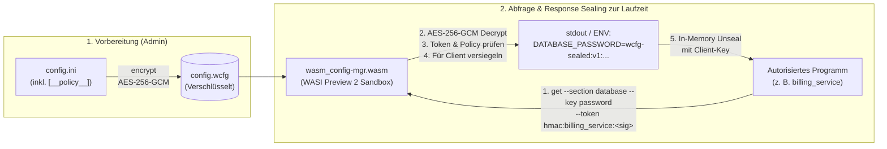

# `wasm_config-mgr` — WASI Preview 2 AES-256-GCM INI Configuration Manager

-654FF0?logo=webassembly)


-2ea44f)

`wasm_config-mgr` ist ein in Rust entwickeltes **WebAssembly System Interface (WASI Preview 2)** Programm zur sicheren Verwaltung sensibler Konfigurationsdaten im INI-Format.

Es verschlüsselt INI-Dateien inklusive eines eingebetteten Zugriffs-Manifests (`[__policy__]`) mittels **AES-256-GCM** und stellt autorisierten Fremdprogrammen nach kryptografischer Token- und Berechtigungsprüfung gezielt einzelne Einträge als **Ende-zu-Ende versiegelte Umgebungsvariable (`ENV_KEY=wcfg-sealed:v1:...`)** über `stdout` zur Verfügung – sodass niemals Klartext-Geheimnisse auf `stdout`, in Logs oder in `/proc/<pid>/environ` exponiert werden.

---

## Inhaltsverzeichnis

1. [Hauptmerkmale](#hauptmerkmale)
2. [Architektur & Sicherheitsmodell](#architektur--sicherheitsmodell)
3. [Build & Installation](#build--installation)
4. [Beispiel-INI mit Policy-Manifest](#beispiel-ini-mit-policy-manifest)
5. [Verschlüsselung & Entschlüsselung](#verschlüsselung--entschlüsselung)
6. [Autorisierung, Response Sealing & Nutzung durch andere Programme](#autorisierung-response-sealing--nutzung-durch-andere-programme)
7. [Vollständiges Praxisbeispiel (`./Example`)](#vollständiges-praxisbeispiel-example)
8. [CLI-Referenz](#cli-referenz)
9. [Binäres Containerformat (`WCFG`)](#binäres-containerformat-wcfg)
10. [Tests & Spec-Driven Development (`sdd`)](#tests--spec-driven-development-sdd)

---

## Hauptmerkmale

- **Authentifizierte Verschlüsselung im Ruhezustand (AES-256-GCM):** Schützt sowohl die Vertraulichkeit als auch die Integrität der gesamten INI-Datei. Der 34-Byte-Container-Header wird als *Associated Data (AAD)* authentifiziert, sodass jegliche Manipulation am Header oder Ciphertext sofort erkannt wird.
- **Ende-zu-Ende Response Sealing (Kein Klartext auf `stdout`):**
  - Selbst nach erfolgreicher Autorisierung gibt `get` den Konfigurationswert **niemals im Klartext** auf `stdout` aus, sondern verschlüsselt ihn gezielt für den anfragenden Client mit AES-256-GCM (`wcfg-sealed:v1:hmac:...` bzw. asymmetrisch über ephemeres Curve25519-ECDH `wcfg-sealed:v1:ed25519:...`).
  - Der Ziel-Umgebungsvariablenname, die `client_id`, `section` und `key` werden als AAD in den GCM-Authentication-Tag der Antwort eingebunden.
  - Erst das autorisierte Zielprogramm entsiegelt (`unseal` / Rust-API `unseal_env_value`) den Wert in seinem eigenen Arbeitsspeicher (`Zeroizing<String>`).
- **Flexibles Schlüsselmanagement:**
  - **Direkter 256-Bit-Master-Key** (64 Hex-Zeichen, 44 Base64-Zeichen oder 32 ASCII-Bytes) über Umgebungsvariable (`WASM_CONFIG_MASTER_KEY`), Keyfile oder CLI-Parameter.
  - **Passphrasen-Ableitung via Argon2id** (128-Bit Zufalls-Salt im Header) über `WASM_CONFIG_PASSPHRASE` oder `--passphrase`.
- **Eingebettetes Policy-Manifest (`[__policy__]`):** Die Zugriffsregeln (welcher Client welche `section.key`-Einträge lesen darf, inkl. Wildcards wie `stripe.*`) sind direkt in der verschlüsselten INI-Datei hinterlegt und somit selbst vor Manipulation geschützt.
- **Kryptografische Client-Autorisierung:** Unterstützt sowohl **HMAC-SHA256** als auch **Ed25519**-Signaturen über kanonische Anfragen (`wasm-config-mgr:v1:<client_id>:<section>:<key>`).
- **Speichersicherheit:** Sensible Schlüsselmaterialien und entschlüsselte Klartexte im RAM werden nach Gebrauch automatisch mit `zeroize` überschrieben.

---

## Architektur & Sicherheitsmodell



Das Projekt ist gemäß der [Verfassung](constitution.md) in vier Schichten unterteilt:

| Schicht | Modul | Verantwortung |
| :--- | :--- | :--- |
| **INI & Policy** | [`src/ini/mod.rs`](src/ini/mod.rs) | Reines Parsing, Serialisierung und Extraktion der `[__policy__]`-Regeln |
| **Kryptografie** | [`src/crypto/mod.rs`](src/crypto/mod.rs) | `WCFG`-Containerformat, AES-256-GCM (mit Header-AAD), Argon2id-KDF & Ende-zu-Ende Response Sealing |
| **Autorisierung** | [`src/auth/mod.rs`](src/auth/mod.rs) | HMAC-SHA256 (Constant-Time) & Ed25519 Token-Prüfung sowie Allowlist-Matching |
| **CLI & ENV** | [`src/cli/mod.rs`](src/cli/mod.rs) | WASI-CLI-Parsing, Dateizugriff, versiegelte ENV-Formatierung und `unseal` |

---

## Build & Installation

### Voraussetzungen

- **Rust Toolchain** (`rustc` / `cargo`) mit installiertem Target `wasm32-wasip2`:
  ```bash
  rustup target add wasm32-wasip2
  ```
- Eine WASI-Preview-2-kompatible Laufzeitumgebung wie [`wasmtime`](https://wasmtime.dev/) (oder Ausführung als natives Binary).

### Kompilieren

```bash
# 1. Als WASI Preview 2 WebAssembly-Modul bauen (Release)
cargo build --target wasm32-wasip2 --release
# Artefakt: target/wasm32-wasip2/release/wasm_config-mgr.wasm

# 2. Alternativ: Als natives Binary für das Host-System bauen
cargo build --release
# Artefakt: target/release/wasm_config-mgr
```

---

## Beispiel-INI mit Policy-Manifest

Eine INI-Datei enthält neben den regulären Konfigurationssektionen die reservierte Sektion `[__policy__]`. Dort werden alle autorisierten Clients mit ihrem kryptografischen Schlüssel (`hmac_secret` oder `ed25519_pubkey`) und ihren erlaubten Zugriffsmustern (`allow`) definiert.

Erstelle eine Datei `app_config.ini`:

```ini
# ============================================================================
# Zugriffs-Manifest (wird zusammen mit der Datei AES-256-GCM verschlüsselt)
# ============================================================================
[__policy__]
# Client 1: "billing_service" authentifiziert sich mittels HMAC-SHA256
# Erlaubt sind exakt "database.password", "database.host" sowie alle Schlüssel unter "stripe.*"
client.billing_service.hmac_secret = 00112233445566778899aabbccddeeff00112233445566778899aabbccddeeff
client.billing_service.allow = database.password, database.host, stripe.*

# Client 2: "audit_worker" authentifiziert sich mittels Ed25519 Public Key (64 Hex-Zeichen)
# Erlaubt ist ausschließlich der Eintrag "logging.endpoint"
client.audit_worker.ed25519_pubkey = d75a980182b10ab7d54bfed3c964073a0ee172f3daa62325af021a68f707511a
client.audit_worker.allow = logging.endpoint

# ============================================================================
# Anwendungs-Konfiguration
# ============================================================================
[database]
host = "db.internal.example.com"
port = 5432 ; Standard PostgreSQL Port
password = "s3cr3t_db_p@ssw0rd!"

[stripe]
api_key = "sk_live_9876543210abcdef"
webhook_secret = "whsec_1234567890abcdef"

[logging]
endpoint = "https://logs.internal.example.com/ingest"
```

> [!IMPORTANT]
> Die Sektion `[__policy__]` kann über den `get`-Befehl **niemals** ausgelesen werden – selbst dann nicht, wenn ein Client `allow = *.*` besitzt.

---

## Verschlüsselung & Entschlüsselung

### Variante A: Verschlüsselung mit einem 256-Bit Master-Key (Empfohlen für Services)

Der Master-Key (32 Bytes / 64 Hex-Zeichen) wird über die Umgebungsvariable `WASM_CONFIG_MASTER_KEY` (oder `--raw-key` / `--key-file`) übergeben:

```bash
export WASM_CONFIG_MASTER_KEY="0123456789abcdef0123456789abcdef0123456789abcdef0123456789abcdef"

# Mit Wasmtime (capability-based: nur aktuelles Verzeichnis freigeben)
wasmtime run --dir=. --env WASM_CONFIG_MASTER_KEY \
  target/wasm32-wasip2/release/wasm_config-mgr.wasm \
  encrypt --input app_config.ini --output app_config.wcfg
```

### Variante B: Verschlüsselung mit einer Passphrase (Argon2id-KDF)

Wenn statt eines Raw-Keys eine Passphrase genutzt wird, leitet `wasm_config-mgr` mittels **Argon2id** (19 MiB RAM, 2 Iterationen, 16-Byte Zufalls-Salt) automatisch einen 256-Bit-AES-Schlüssel ab:

```bash
export WASM_CONFIG_PASSPHRASE="correct-horse-battery-staple-2026!"

wasmtime run --dir=. --env WASM_CONFIG_PASSPHRASE \
  target/wasm32-wasip2/release/wasm_config-mgr.wasm \
  encrypt --input app_config.ini --output app_config.wcfg
```

### Vollständige Entschlüsselung (für Administratoren)

```bash
# Ausgabe in eine Datei (oder ohne --output auf stdout)
wasmtime run --dir=. --env WASM_CONFIG_MASTER_KEY \
  target/wasm32-wasip2/release/wasm_config-mgr.wasm \
  decrypt --input app_config.wcfg --output app_config.decrypted.ini
```

---

## Autorisierung, Response Sealing & Nutzung durch andere Programme

Um einen Konfigurationswert aus `app_config.wcfg` abzufragen, benötigt das anfragende Programm ein kryptografisches Zugriffs-Token für das Tripel `(client_id, section, key)`.

Die kanonische Nachricht, die vom Client signiert wird, lautet:
```text
wasm-config-mgr:v1:<client_id>:<section>:<key>
```

### 1. Zugriffs-Token generieren

Ein Token kann entweder vom anfragenden Programm selbst (mit dessen HMAC-Secret bzw. Ed25519-Private-Key) berechnet oder über das Subkommando `token` erzeugt werden:

```bash
# HMAC-SHA256 Token für Client "billing_service" auf "database.password" erzeugen
TOKEN=$(wasmtime run target/wasm32-wasip2/release/wasm_config-mgr.wasm \
  token \
  --client billing_service \
  --section database \
  --key password \
  --hmac-secret 00112233445566778899aabbccddeeff00112233445566778899aabbccddeeff)

echo "$TOKEN"
# Ausgabe:
# hmac:billing_service:e8b8c04d34926c4b14e070894f620ff9c6e2f20b56f0d0407368089f97e12a10
```

Für **Ed25519** wird analog `--ed25519-privkey <64-hex-seed>` übergeben:
```bash
ED_TOKEN=$(wasmtime run target/wasm32-wasip2/release/wasm_config-mgr.wasm \
  token \
  --client audit_worker \
  --section logging \
  --key endpoint \
  --ed25519-privkey 9d61b19deffd5a60ba844af492ec2cc44449c5697b326919703bac031cae7f60)
```

### 2. Eintrag Ende-zu-Ende versiegelt als ENV abrufen (`get`)

Beim Abruf über `get` wird das Geheimnis **niemals im Klartext** auf `stdout` ausgegeben. Stattdessen verschlüsselt `wasm_config-mgr` die Antwort mit einem aus dem Client-Schlüssel und dem Kontext (`client_id`, `section`, `key`, `env_name`) abgeleiteten AES-256-GCM-Schlüssel:

#### Standardausgabe (`SECTION_KEY=wcfg-sealed:v1:...`)
```bash
wasmtime run --dir=. --env WASM_CONFIG_MASTER_KEY \
  target/wasm32-wasip2/release/wasm_config-mgr.wasm \
  get \
  --input app_config.wcfg \
  --section database \
  --key password \
  --token "$TOKEN"
```
**Versiegelte Ausgabe auf `stdout` (kein Klartext!):**
```dotenv
DATABASE_PASSWORD=wcfg-sealed:v1:hmac:7f91c2a0b1e48d1122334455:9c41f77a0184e9021b5e3f810c11a9d23d841e6b4f22c8109a3b5c7d1e2f3a4b5c6d7e
```

#### Eigener Variablenname & Shell-Export (`--env-name` + `--export`)
```bash
wasmtime run --dir=. --env WASM_CONFIG_MASTER_KEY \
  target/wasm32-wasip2/release/wasm_config-mgr.wasm \
  get \
  --input app_config.wcfg \
  --section database \
  --key password \
  --token "$TOKEN" \
  --env-name PGPASSWORD \
  --export
```
**Versiegelte Ausgabe auf `stdout`:**
```bash
export PGPASSWORD='wcfg-sealed:v1:hmac:4a10e8f29c1130bb81234567:3e881a4b90c21f5e7a6d112233445566778899aabbccddeeff00112233445566778899'
```

> [!NOTE]
> Da in der Umgebungsvariable `PGPASSWORD` nur das versiegelte Token `wcfg-sealed:v1:...` steht, sehen andere Prozesse oder Benutzer selbst bei einem Blick in `env`, `ps e` oder Terminal-Logs niemals das echte Passwort.

### 3. Entsiegelung durch das autorisierte Zielprogramm (`unseal`)

Das autorisierte Zielprogramm liest die versiegelte Umgebungsvariable `DATABASE_PASSWORD` aus seiner Umgebung und entsiegelt sie direkt im Arbeitsspeicher:

#### A) In Rust (In-Memory über die Bibliothek `wasm_config_mgr`)
```rust
use wasm_config_mgr::cli::{unseal_env_value, TokenKeySpec};

let sealed_env = std::env::var("DATABASE_PASSWORD")?;
let secret = hex::decode("00112233445566778899aabbccddeeff00112233445566778899aabbccddeeff")?;

// Entschlüsselt den Wert direkt in einen Zeroizing<String>-Speicherbereich
// und prüft gleichzeitig die AAD-Bindung (client_id, section, key, env_name):
let db_password = unseal_env_value(
    &sealed_env,
    "billing_service",
    "database",
    "password",
    Some("DATABASE_PASSWORD"),
    &TokenKeySpec::HmacSecret(secret),
)?;
```

#### B) Über die CLI (`unseal`)
Falls das Zielprogramm den versiegelten Wert aus der gesetzten Umgebungsvariable über das WASI-Modul entsiegeln möchte:
```bash
# Liest automatisch $DATABASE_PASSWORD aus der Umgebung (oder via --sealed <wert>)
wasmtime run --env DATABASE_PASSWORD \
  target/wasm32-wasip2/release/wasm_config-mgr.wasm \
  unseal \
  --client billing_service \
  --section database \
  --key password \
  --hmac-secret 00112233445566778899aabbccddeeff00112233445566778899aabbccddeeff
```

### 4. Verhalten bei unautorisierten Anfragen oder Manipulation (Fail-Closed)

- **Gefälschtes oder wiederverwendetes Anfrage-Token:** Wird ein Token für `database.password` auf `database.port` angewendet, schlägt die Signaturprüfung fehl (Exit-Code `1`, keine Ausgabe auf `stdout`).
- **Vertauschte Umgebungsvariable (Context-Binding):** Da `client_id`, `section`, `key` und `env_name` als AAD in den AES-256-GCM-Tag des versiegelten Werts eingerechnet sind, schlägt `unseal` sofort mit `AuthenticationFailed` fehl, wenn ein Angreifer versucht, den versiegelten Wert einer anderen Umgebungsvariable zuzuweisen.

---

## Vollständiges Praxisbeispiel (`./Example`)

Im Ordner [`./Example`](Example/) befindet sich ein direkt ausführbares Ende-zu-Ende-Beispiel, das zeigt, wie eine Python-Anwendung eine Datenbank-Konfiguration verschlüsselt, autorisiert abfragt und im eigenen Arbeitsspeicher entsiegelt:

- **[`Example/README_de.md`](Example/README_de.md):** Detailbeschreibung des Beispiels und des kryptografischen Ablaufs.
- **[`Example/db_config.ini`](Example/db_config.ini):** Beispiel-INI mit `[__policy__]`-Freigaben für `python_db_app` (`allow = database.*`), einer `[database]`-Sektion (`host`, `port`, `name`, `user`, `password`, `ssl_mode`) und einer gesperrten `[admin]`-Sektion.
- **[`Example/query_db_config.py`](Example/query_db_config.py):** Python-Skript, das:
  1. `Example/db_config.ini` nach `Example/db_config.wcfg` (AES-256-GCM) verschlüsselt,
  2. für jeden Datenbank-Parameter das HMAC-SHA256-Zugriffs-Token berechnet,
  3. über `wasm_config-mgr get` die Ende-zu-Ende versiegelten Umgebungsvariablen (`DB_PASSWORD=wcfg-sealed:v1:hmac:...`) abruft und in `os.environ` speichert,
  4. die Werte direkt im Python-Arbeitsspeicher (`unseal_in_memory_python` via AES-256-GCM + AAD-Verifikation) entsiegelt und
  5. in einem Negativ-Test demonstriert, dass ein unautorisierter Zugriff auf `[admin] root_api_token` abgewiesen wird.

```bash
python3 Example/query_db_config.py
```

---

## CLI-Referenz

```text
wasm_config-mgr — WASI Preview 2 AES-256-GCM INI Configuration Manager

USAGE:
  wasm_config-mgr encrypt --input <file.ini> --output <file.wcfg> [KEY_OPTIONS]
  wasm_config-mgr decrypt --input <file.wcfg> [--output <file.ini>] [KEY_OPTIONS]
  wasm_config-mgr get     --input <file.wcfg> --section <sec> --key <k> --token <tok> [--env-name <ENV>] [--export] [KEY_OPTIONS]
  wasm_config-mgr unseal  [--sealed <val>] --client <id> --section <sec> --key <k> [--env-name <ENV>] (--hmac-secret <sec> | --ed25519-privkey <hex>)
  wasm_config-mgr token   --client <id> --section <sec> --key <k> (--hmac-secret <sec> | --ed25519-privkey <hex>)

KEY_OPTIONS:
  --raw-key <hex|base64>        Direkter 256-Bit AES Master-Key (64 Hex-Zeichen, 44 Base64-Zeichen oder 32 ASCII-Bytes)
  --passphrase <str>            Passphrase für Argon2id-Schlüsselableitung
  --key-file <path>             Pfad zu einer Schlüsseldatei mit dem 256-Bit-Key
  --key-env <ENV>               Name der ENV-Variable für den Raw-Key (Standard: WASM_CONFIG_MASTER_KEY)
  --passphrase-env <ENV>        Name der ENV-Variable für die Passphrase (Standard: WASM_CONFIG_PASSPHRASE)
```

---

## Binäres Containerformat (`WCFG`)

Jede verschlüsselte Datei besitzt einen 34 Byte langen Binärheader, der vollständig als Associated Data (AAD) in den 128-Bit AES-256-GCM Authentication Tag einfließt:

| Offset | Länge | Feld | Beschreibung |
| :--- | :--- | :--- | :--- |
| `0..4` | 4 Bytes | `Magic` | ASCII `WCFG` (`0x57 0x43 0x46 0x47`) |
| `4` | 1 Byte | `Version` | Formatversion (`0x01`) |
| `5` | 1 Byte | `KDF` | `0x00` = Raw 256-Bit Key, `0x01` = Argon2id |
| `6..22` | 16 Bytes | `Salt` | 128-Bit Zufalls-Salt für Argon2id (bei Raw-Key `0x00..00`) |
| `22..34` | 12 Bytes | `Nonce` | 96-Bit kryptografisch zufälliger AES-GCM Nonce |
| `34..N` | variabel | `Ciphertext` | AES-256-GCM verschlüsselter INI-Payload |
| `N..N+16` | 16 Bytes | `AuthTag` | 128-Bit GCM Authentication Tag über Header (AAD) + Ciphertext |

---

## Tests & Spec-Driven Development (`sdd`)

Dieses Projekt wird nach **Spec-Driven Development (`sdd`)** im Profil `standard` entwickelt und validiert:

- **Verfassung:** [`constitution.md`](constitution.md)
- **Architekturentscheidungen (ADRs):**
  - [`docs/adr/0001-wasi-aes256-architecture.md`](docs/adr/0001-wasi-aes256-architecture.md)
  - [`docs/adr/0002-response-sealing-no-plaintext-stdout.md`](docs/adr/0002-response-sealing-no-plaintext-stdout.md)
- **Product Requirements Document (PRD):** [`docs/prd/wasm-config-mgr.md`](docs/prd/wasm-config-mgr.md) (`AC-1` bis `AC-7`)
- **Tech Spec:** [`docs/design/wasm-config-mgr.md`](docs/design/wasm-config-mgr.md)
- **Umsetzungsplan:** [`docs/plans/wasm-config-mgr.md`](docs/plans/wasm-config-mgr.md)

### Automatisierte Tests und SDD-Gates ausführen

```bash
# Alle Unit- und Integrations-Tests (AC-1 bis AC-7) ausführen
cargo test

# SDD Linter & Gates prüfen
sdd lint
sdd gate pre-merge
sdd gate pre-release
sdd report --format markdown
```
